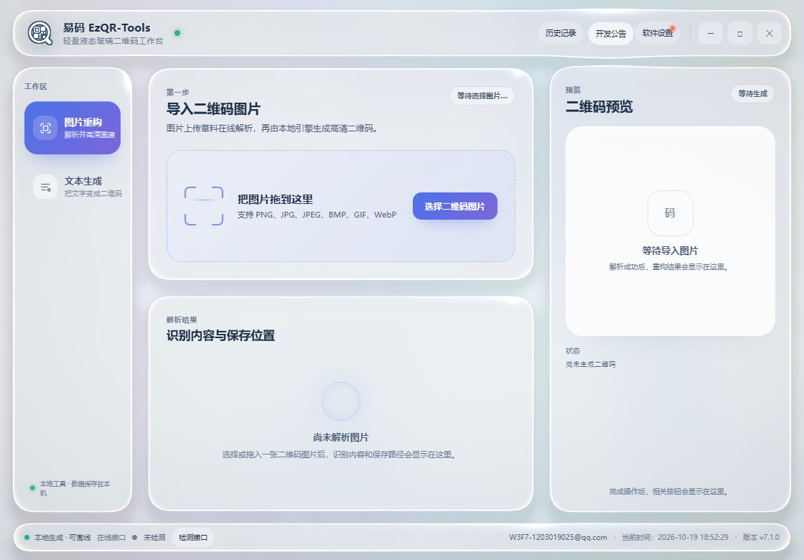
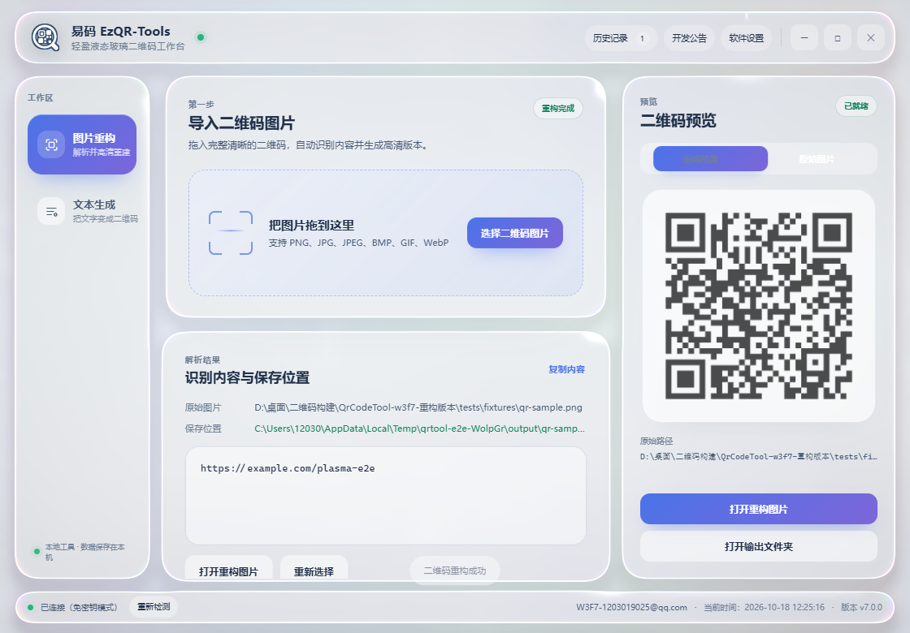
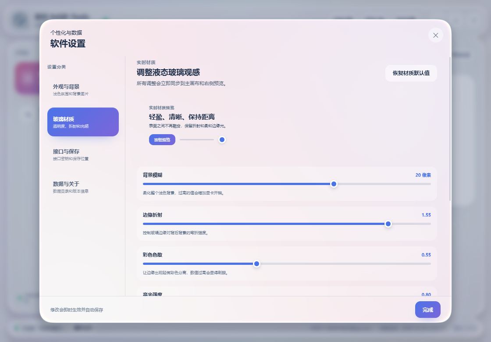
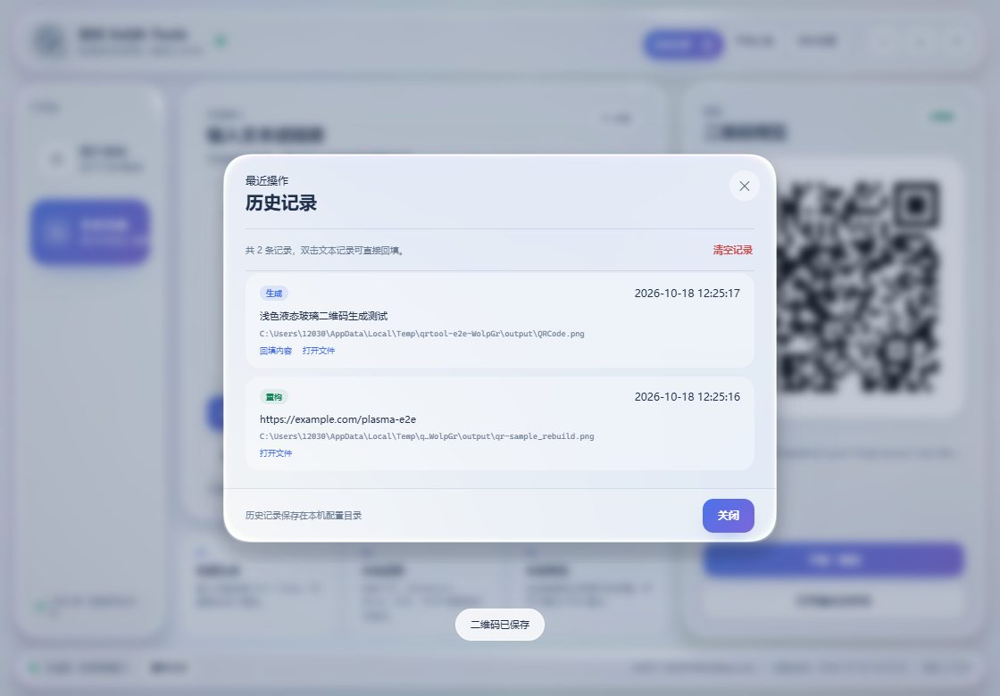
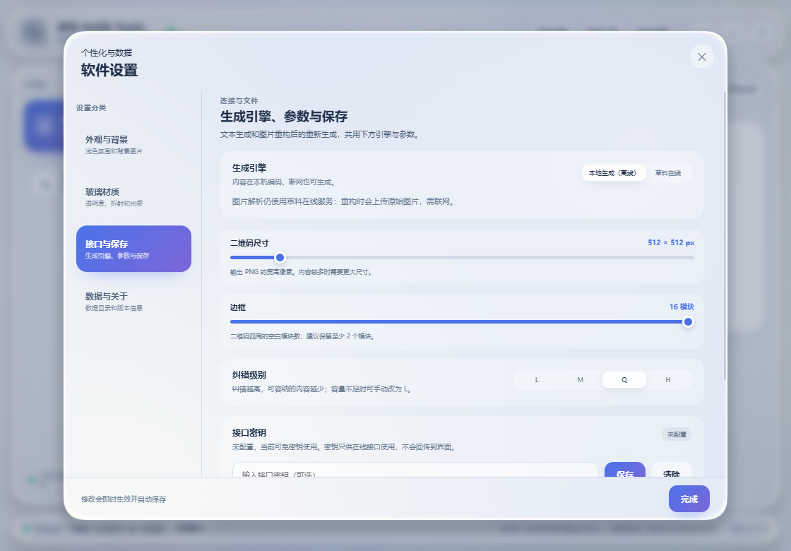
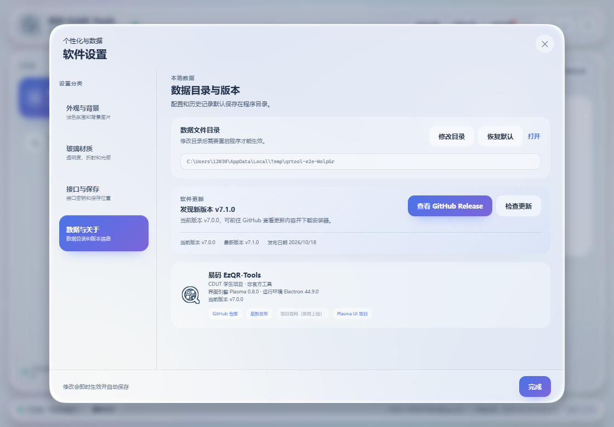

<div align="center">


# 易码 EzQR-Tools

**二维码解析与生成，简单一点。**

一款轻盈、清晰的桌面二维码工具。拖入图片即可解析并重构，输入文字即可生成二维码，不必在多个网站之间来回切换。


[](https://github.com/PowerT-0704/EzQR-Tools/releases/latest)
[](https://github.com/PowerT-0704/EzQR-Tools)

<sub>CDUT 学生项目 · 非官方工具 · Windows x64</sub>

</div>

<p align="center">
  
</p>

<p align="center"><sub>浅色液态玻璃工作台：左侧切换工作区，右侧固定预览，高频操作在一屏内完成。</sub></p>

## ✨ 为什么是 EzQR

| | 能做什么 |
| --- | --- |
| 🖼️ 图片重构 | 拖入二维码图片，自动读取内容并重新生成高清 PNG，原图与结果可随时切换预览 |
| ⌨️ 本地生成 | 输入文字、链接或多行内容，断网也可生成二维码并下载，支持尺寸、纠错与边框设置 |
| 🗂️ 本地文档 | 支持 TXT、Markdown、JSON、Word、ODT、RTF 等常见文本格式 |
| 🕘 操作记录 | 生成与重构记录统一保存在历史弹窗，支持回填和打开文件 |
| 🪟 轻盈外观 | 基于 Plasma UI 的浅色液态玻璃界面，提供晨雾蓝、樱花粉、薄荷青三种氛围 |
| 🎛️ 材质调节 | 模糊、折射、色散、高光、磨砂和动效参数实时生效 |
| 🔄 更新提示 | 启动时静默检查 GitHub Release，在软件设置中提示可用新版本 |
| 🔒 本地优先 | 接口密钥、文件读写和网络请求都只在 Electron 主进程处理 |

## 🖥️ 界面一览

<p align="center">
  
</p>

<p align="center"><sub>图片重构工作区：解析、保存位置和二维码预览保持在同一视觉层级。</sub></p>

| 设置 | 历史记录 |
| --- | --- |
|  |  |

<p align="center">
  
</p>

<p align="center"><sub>v7.1 新增生成引擎与二维码参数；图片解析仍使用草料在线服务。</sub></p>

<p align="center">
  
</p>

<p align="center"><sub>软件设置会自动检查 GitHub Releases，并显示当前版本与可用更新。</sub></p>

## 🚀 下载与安装

Windows 10/11 x64 用户可直接下载最新安装器：

**[下载易码 EzQR-Tools v7.1.0](https://github.com/PowerT-0704/EzQR-Tools/releases/tag/v7.1.0)**

Release 提供 [Windows x64 安装器](https://github.com/PowerT-0704/EzQR-Tools/releases/download/v7.1.0/EzQR-Tools-7.1.0-x64-Setup.exe) 和 [SHA-256 校验文件](https://github.com/PowerT-0704/EzQR-Tools/releases/download/v7.1.0/SHA256SUMS-7.1.0.txt)。从源码构建时，产物位于本地 `release` 目录。

安装器当前未进行代码签名，首次运行时 Windows SmartScreen 可能显示提示。安装与使用步骤：

1. 从 GitHub Releases 下载 `EzQR-Tools-7.1.0-x64-Setup.exe`。
2. 运行安装器，选择安装目录和需要的快捷方式。
3. 启动后拖入二维码图片，或切换到“文本生成”输入内容。
4. 在“软件设置 → 数据与关于”中检查 GitHub 最新版本。

卸载前请备份安装目录下的 `config` 文件夹，配置和历史记录默认保存在该目录。

### 从源码运行

1. **准备环境**：安装 Node.js 24 或更高版本。
2. **安装依赖并启动**：在项目目录执行 `npm ci`，然后运行 `npm run dev`。
3. **开始处理**：把二维码图片拖进窗口，或切换到“文本生成”输入内容。

```powershell
npm ci
npm run dev
```

如果当前 npm 策略阻止 Electron 安装脚本，可在项目目录补跑：

```powershell
npx install-electron --no
```

## 🧭 当前能力边界

- 文本生成默认使用本地编码器，无需联网或接口密钥；重构后的重新编码也默认在本机完成。
- 图片解析仍使用草料开放接口，需要上传所选图片。完整离线重构安排在 v7.2，见 **[未来路线图](docs/ROADMAP.md)**。
- “软件设置 → 接口与保存”可明确切换本地或草料生成；只有手动选择在线生成时才上传文本，本地失败不会自动切换。
- 默认输出 1024×1024 PNG、M 纠错、2 模块边框；支持 128–4096 像素、L/M/Q/H 和 0–16 模块边框。边框为 0 时扫描器可能需要图片外的白色留白。
- 已移除旧的 900 字警告与 2000 字导入限制；950 个常见汉字使用 L 纠错可生成。容量取决于内容编码与纠错级别，不能无限增加；不足时会提示手动调整。
- 生成保留首尾空白和换行。文本导入仍限制 5 MB 文件、5 万字符，防止意外导入过大文档。
- 启动不再自动检测草料生成接口；手动接口检测和 GitHub 静默更新检查仍会联网。
- 应用内更新检查只提示新版本并打开 GitHub Release，不自动下载或安装。
- 项目官网入口保留为“即将上线”；项目源码、问题反馈和版本发布统一使用 GitHub。

## 🛠️ 技术架构

```text
React + TypeScript Renderer
        │
        │ typed IPC
        ▼
Electron Preload
        │
        ▼
Electron Main
├── QrCodeEngine / 本地 qrcode 编码器
├── 草料适配器（图片解析与可选在线生成）
├── 文件 / 图片 / 文本导入
├── 配置与历史存储
├── 输出路径策略
└── 窗口与系统能力
```

- **桌面框架**：Electron 44
- **界面**：React 19、TypeScript、Plasma UI 0.8
- **构建**：electron-vite、electron-builder
- **测试**：Vitest、Playwright Electron
- **渲染**：WebGL2 液态玻璃，WebGL2 不可用时自动回退 CSS 磨砂

## 🧑‍💻 本地开发

```powershell
npm ci
npm run dev
```

常用命令：

```powershell
npm run typecheck   # 主进程与渲染进程类型检查
npm run lint        # ESLint
npm test            # 单元测试
npm run test:e2e    # Electron 端到端测试
npm run build       # 生产构建
npm run dist:win    # Windows x64 NSIS 安装器
```

安装器输出到 `release\EzQR-Tools-7.1.0-x64-Setup.exe`，不会生成 ZIP。安装器当前未进行代码签名，Windows 可能显示 SmartScreen 提示；卸载前请备份安装目录下的 `config` 文件夹。

可选的草料适配器联网冒烟测试（会上传指定图片，并调用在线生成；不代表默认本地生成流程）：

```powershell
npm run test:api -- "X:\path\to\qrcode.png"
```

品牌图标可从 `resources/logo-source.png` 重新生成：

```powershell
python scripts/generate_brand_assets.py
```

该脚本仅用于生成 PNG/ICO 资源，需要开发机安装 Pillow，不是应用运行依赖。

## 🔐 数据与安全

- 默认数据目录：程序目录下的 `config`。
- 配置文件：`config/config.json`；历史文件：`config/history.json`。
- 接口密钥只由主进程读取，不会通过 IPC 返回给渲染界面。
- 渲染进程启用 sandbox 与 context isolation，禁用 Node integration。
- 不采集桌面，不截图，也不包含窗口后方桌面的实时折射。
- 自定义数据目录通过根目录的 `data_dir.txt` 指定，修改后可一键重启生效。

## 🗺️ 未来规划

下一阶段的核心目标是 **Local-first**：让二维码生成、解析和图片重构不依赖外部在线服务。

| 版本 | 目标 |
| --- | --- |
| `v7.1`（已完成） | 本地二维码编码器、离线文本生成、重构后本地编码与可选在线生成 |
| `v7.2` | 引入本地 ZXing/WASM 解码，图片解析与重构不再依赖草料接口 |
| `v7.3` | 默认离线运行，草料接口作为可选在线适配器；普通用户无需 API Key |
| 后续 | 批量处理、SVG/PDF、二维码样式、Logo 嵌入、自动更新与跨平台构建 |

详细拆分、技术选型和验收标准见 **[docs/ROADMAP.md](docs/ROADMAP.md)**。

## ❤️ 致谢

- [Plasma UI](https://github.com/CruxGarden/plasma-ui)：WebGL 液态玻璃组件与渲染引擎。
- [Electron](https://www.electronjs.org/)、[React](https://react.dev/) 与 TypeScript 社区。
- [qrcode](https://github.com/soldair/node-qrcode) 提供纯 JavaScript 本地二维码编码。
- 草料开放接口提供图片解析和可选在线生成能力。
- 感谢所有参与测试、反馈问题和改进体验的同学。

## 📄 授权

本项目以 [MIT License](LICENSE) 发布。

问题反馈与功能建议请使用 [GitHub Issues](https://github.com/PowerT-0704/EzQR-Tools/issues)。

<div align="center">

<sub>易码 EzQR-Tools 是 CDUT 学生项目，与学校及草料官方无隶属关系。</sub>

</div>

